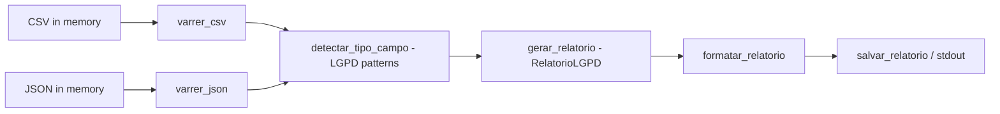

# relatorio-compliance-lgpd

**English** · [Português (Brasil)](README.md)

[](#) [](#) [](LICENSE)

## What it is

A **LGPD compliance report** generator built on personal-data mapping: it scans synthetic sources (CSV/JSON **in memory**), **detects personal-data fields** by name pattern (CPF, e-mail, phone, address, etc.), classifies risk and builds a report with the count per type. It is an educational lab in pure Python, with no dependencies.

> Note: the previous README described an **ML fraud-detection** project (creditcard.csv, RandomForest) — it does not exist here. Corrected.

## Status

An educational lab, working, with 15 tests.

## Features

- **In-memory CSV scan** (`varrer_csv`) and **JSON scan** (`varrer_json`): detect personal fields by name pattern.
- **Field type detection** (`detectar_tipo_campo`): classifies personal-data patterns.
- **Risk classification** by type and occurrences (`_classificar_risco`).
- **Aggregated report** (`RelatorioLGPD`): total personal fields and counts per type; a `tem_dados_pessoais` flag.
- **Generation, formatting and saving**: `gerar_relatorio`, `formatar_relatorio`, `salvar_relatorio`.
- **CLI**: `python -m relatorio_compliance_lgpd.mapeamento` prints the report from the synthetic sources.

## Architecture

A single `mapeamento.py` module with scan functions (CSV/JSON), dataclass models (`CampoPessoal`, `FonteDado`, `RelatorioLGPD`) and report generation/output. The `main()` uses `fontes_sinteticas()` and prints the formatted result.



## Stack

- Python ≥ 3.10, stdlib only (no dependencies)
- dataclasses
- pytest (dev)

## Repository layout

```
relatorio-compliance-lgpd/
├── pyproject.toml · BRIEF.md
├── src/relatorio_compliance_lgpd/
│   └── mapeamento.py   # scan, models and LGPD report
├── tests/test_mapeamento.py
└── LICENSE             # MIT
```

## Prerequisites and installation

Python ≥ 3.10.

```bash
pip install -e .
```

## How to run

CLI:

```bash
python -m relatorio_compliance_lgpd.mapeamento
# prints the LGPD report from the synthetic sources

# or, after `pip install -e .`:
relatorio-lgpd
```

Programmatic use:

```python
from relatorio_compliance_lgpd.mapeamento import fontes_sinteticas, gerar_relatorio, salvar_relatorio

relatorio = gerar_relatorio(fontes_sinteticas())
salvar_relatorio(relatorio, "relatorio.txt")
print(relatorio.total_campos_pessoais)
```

## Tests and quality

Real run (verified by the agent):

```bash
python -m pytest tests/
# 15 passed
```

## Technical decisions and trade-offs

- **Name-pattern detection** instead of semantic inspection of values: simple and deterministic; it may produce false positives/negatives for atypical names.
- **In-memory sources** (no dependency on fixed files): easy to test; the `main()` uses embedded synthetic sources.

## Known limitations and roadmap

- Detection covers common field-name patterns, not every possible naming.
- The sources are synthetic; for real use, integrate your own CSVs/JSONs via `varrer_csv`/`varrer_json`.

## Development process

An individual project by Kelvin Oliveira, built with orchestrated AI agents and reviewed by the author. The LGPD mapping and the review are the author's.

## License and author

MIT — Copyright (c) 2026 Kelvin Rebelo de Oliveira.

**Author**: [Kelvin Oliveira](https://github.com/KelvinOliveiraCode) · [Portfolio](https://kelvinoliveiracode.github.io/portfolio/)
