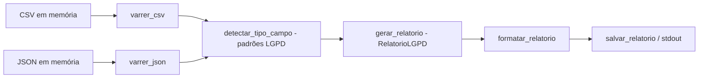

# relatorio-compliance-lgpd

[English](README.en.md) · **Português (Brasil)**

[](#) [](#) [](LICENSE)

## O que é

Gerador de **relatório de compliance LGPD** por mapeamento de dados pessoais: varre fontes sintéticas (CSV/JSON **em memória**), **detecta campos de dados pessoais** por padrão de nome (CPF, e-mail, telefone, endereço, etc.), classifica risco e monta o relatório com a contagem por tipo. É um laboratório educacional em Python puro, sem dependências.

> Nota: o README anterior descrevia um projeto de **ML de detecção de fraude** (creditcard.csv, RandomForest) — não existe aqui. Corrigido.

## Status

Laboratório educacional, funcional, com 15 testes.

## Funcionalidades

- **Varredura de CSV em memória** (`varrer_csv`) e **de JSON** (`varrer_json`): detectam campos pessoais por padrão de nome.
- **Detecção de tipo de campo** (`detectar_tipo_campo`): classifica padrões de dados pessoais.
- **Classificação de risco** por tipo e ocorrências (`_classificar_risco`).
- **Relatório agregado** (`RelatorioLGPD`): total de campos pessoais e contagem por tipo; flag `tem_dados_pessoais`.
- **Geração, formatação e salvamento**: `gerar_relatorio`, `formatar_relatorio`, `salvar_relatorio`.
- **CLI**: `python -m relatorio_compliance_lgpd.mapeamento` imprime o relatório das fontes sintéticas.

## Arquitetura

Um único módulo `mapeamento.py` com funções de varredura (CSV/JSON), modelos dataclass (`CampoPessoal`, `FonteDado`, `RelatorioLGPD`) e a geração/saída do relatório. O `main()` usa `fontes_sinteticas()` e imprime o resultado formatado.



## Stack

- Python ≥ 3.10, stdlib apenas (sem dependências)
- dataclasses
- pytest (dev)

## Estrutura do repositório

```
relatorio-compliance-lgpd/
├── pyproject.toml · BRIEF.md
├── src/relatorio_compliance_lgpd/
│   └── mapeamento.py   # varredura, modelos e relatório LGPD
├── tests/test_mapeamento.py
└── LICENSE             # MIT
```

## Pré-requisitos e instalação

Python ≥ 3.10.

```bash
pip install -e .
```

## Como executar

CLI:

```bash
python -m relatorio_compliance_lgpd.mapeamento
# imprime o relatório LGPD das fontes sintéticas

# ou, após `pip install -e .`:
relatorio-lgpd
```

Uso programático:

```python
from relatorio_compliance_lgpd.mapeamento import fontes_sinteticas, gerar_relatorio, salvar_relatorio

relatorio = gerar_relatorio(fontes_sinteticas())
salvar_relatorio(relatorio, "relatorio.txt")
print(relatorio.total_campos_pessoais)
```

## Testes e qualidade

Execução real (verificada pelo agente):

```bash
python -m pytest tests/
# 15 passed
```

## Decisões técnicas e trade-offs

- **Detecção por padrão de nome de campo** em vez de inspeção semântica do valor: simples e determinística; pode gerar falsos positivos/negativos em nomeações atípicas.
- **Fontes em memória** (sem dependência de arquivos fixos): fácil de testar; o `main()` usa fontes sintéticas embutidas.

## Limitações conhecidas e roadmap

- A detecção cobre padrões comuns de nome de campo, não todas as nomeações possíveis.
- As fontes são sintéticas; para uso real, integre com seus próprios CSVs/JSONs via `varrer_csv`/`varrer_json`.

## Processo de desenvolvimento

Projeto individual de Kelvin Oliveira, construído com agentes de IA orquestrados e revisado pelo autor. O mapeamento LGPD e a revisão são do autor.

## Licença e autor

MIT — Copyright (c) 2026 Kelvin Rebelo de Oliveira.

**Autor**: [Kelvin Oliveira](https://github.com/KelvinOliveiraCode) · [Portfólio](https://kelvinoliveiracode.github.io/portfolio/)
